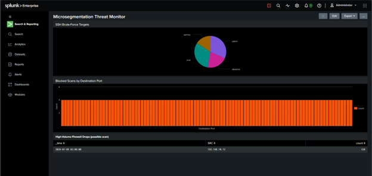
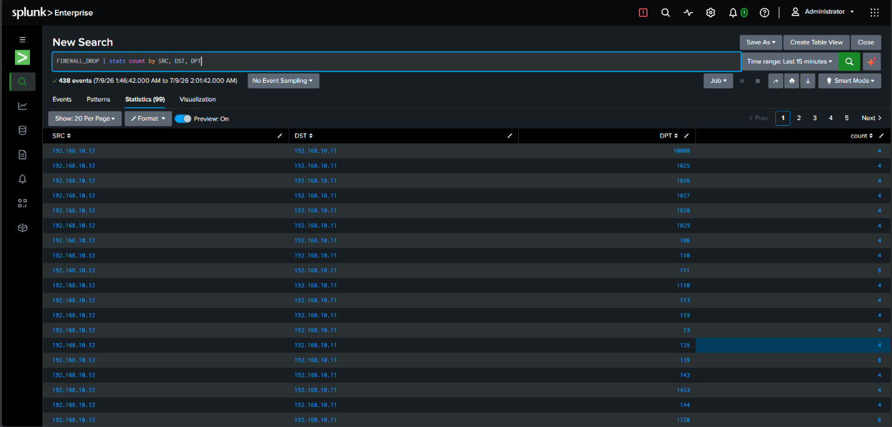
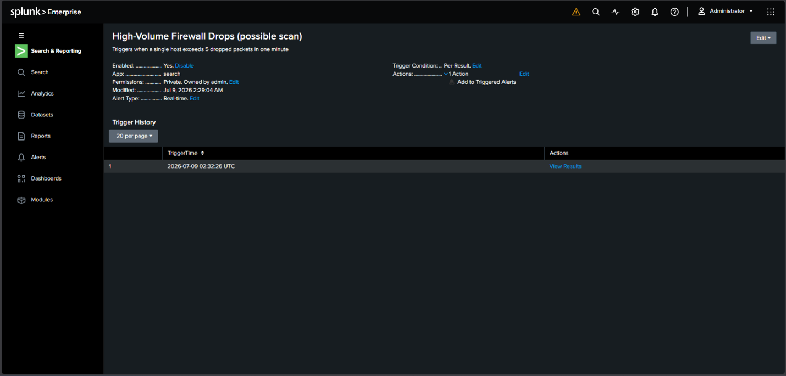

# Microsegmentation Threat Monitor & SIEM Detection Lab


-FCC624?style=flat-square&logo=linux&logoColor=black)


## Executive Summary
Traditional perimeter firewalls monitor North-South traffic entering and leaving a network, but often fail to restrict lateral movement (East-West traffic) once an attacker compromises an internal host. 

This project implements a **host-based micro-segmented network architecture** across virtualized Linux workloads and pairs it with a centralized **Splunk Enterprise SIEM** pipeline. By enforcing strict workload isolation via `iptables` and ingesting real-time kernel and authentication telemetry via Splunk Universal Forwarders, this lab detects, parses, and visualizes multi-stage adversary behavior—specifically horizontal network reconnaissance (**MITRE ATT&CK T1046**) and multi-account SSH credential brute-forcing (**MITRE ATT&CK T1110.001**).

---

## Final SOC Dashboard ("Single Pane of Glass")

*Figure 1: Unified Splunk dashboard correlating application-layer SSH brute-force targets (top), network-layer blocked port scans (middle), and real-time high-volume drop alerts (bottom).*

---

## Lab Architecture & Telemetry Pipeline

The environment consists of three isolated virtual machines operating on an internal subnet (`192.168.10.0/24`), simulating a segmented production tier under attack from a compromised internal host.

```mermaid
flowchart LR
    subgraph Internal_Subnet ["Internal Subnet (192.168.10.0/24)"]
        direction LR
        Attacker["🔴 Attacker VM (Kali)\n192.168.10.12\nTools: Nmap, Hydra"]
        Web["🟡 Web-Server VM\n192.168.10.10\nAuthorized Peer"]
        
        subgraph Microsegmented_Zone ["🔒 Micro-Segmented Workload"]
            DB["🟢 DB-Server VM\n192.168.10.11\niptables Host Firewall\nSplunk Universal Forwarder"]
        end
    end

    subgraph SIEM_Tier ["SOC Monitoring Tier"]
        Splunk["🟣 Splunk Enterprise SIEM\nIndexer & Search Head\nPort: 9997 / 8000"]
    end

    Attacker -- "1. Horizontal Port Scan (Nmap)\n[BLOCKED & LOGGED]" --> DB
    Attacker -- "2. SSH Credential Spray (Hydra)\n[LOGGED TO AUTH.LOG]" --> DB
    Web -- "Permitted DB Traffic\n[ALLOWED]" --> DB
    DB === "Telemetry Stream (TCP/9997)\n/var/log/kern.log\n/var/log/auth.log" ==> Splunk
```

### Component Breakdown
| Asset | IP Address | Role & Security Posture |
| :--- | :--- | :--- |
| **DB-Server** | `192.168.10.11` | Hardened target workload running `iptables` micro-segmentation rules and Splunk Universal Forwarder. |
| **Web-Server** | `192.168.10.10` | Authorized application node permitted to communicate with the database tier. |
| **Attacker VM** | `192.168.10.12` | Adversary simulation host executing internal reconnaissance and credential stuffing. |
| **Splunk Enterprise** | `Localhost:8000` | Central SIEM ingesting host logs, executing RegEx field extractions, and firing real-time alerts. |

---

## Phase 1: Enforcing Micro-Segmentation (`iptables`)

To prevent unauthorized lateral movement to the `DB-Server` (`192.168.10.11`), host-level firewall policies were configured to explicitly log and drop unauthorized packets while prefixing kernel events with `FIREWALL_DROP` for deterministic SIEM parsing:

```bash
# Log unauthorized incoming traffic with a custom SIEM prefix before dropping
sudo iptables -A INPUT -s 192.168.10.12 -j LOG --log-prefix "FIREWALL_DROP: " --log-level 4
sudo iptables -A INPUT -s 192.168.10.12 -j DROP
```

---

## Phase 2: SIEM Telemetry Ingestion

The **Splunk Universal Forwarder** was deployed on the `DB-Server` to continuously monitor both kernel firewall events and Linux authentication logs:

```bash
# Monitor kernel firewall drops and SSH authentication logs
sudo /opt/splunkforwarder/bin/splunk add monitor /var/log/kern.log
sudo /opt/splunkforwarder/bin/splunk add monitor /var/log/auth.log
sudo /opt/splunkforwarder/bin/splunk restart
```

---

## Phase 3: Adversary Emulation (Red Team)

### 1. Network Reconnaissance (MITRE T1046)
From the Attacker VM (`192.168.10.12`), a fast horizontal port scan (`-F`) bypassing ICMP ping checks (`-Pn`) was executed against the protected database workload:
```bash
nmap -Pn -F 192.168.10.11
```

### 2. Multi-Account SSH Brute-Force (MITRE T1110.001)
To simulate an attacker spraying credentials across privileged and service accounts, custom user and password wordlists were generated and executed via `Hydra`:
```bash
echo -e "root\nadmin\ndbadmin\nservice\nguest" > users.txt
echo -e "admin123\npassword\n123456\nroot\nqwerty\nsupersecret" > passwords.txt

hydra -L users.txt -P passwords.txt ssh://192.168.10.11
```

---

## Phase 4: Detection Engineering & SPL Queries (Blue Team)

### 1. Investigating & Visualizing Network-Layer Port Scans
First, raw `FIREWALL_DROP` kernel events were aggregated by source IP (`SRC`), destination IP (`DST`), and destination port (`DPT`) to verify the scope of the lateral scan across 438 blocked packets:
```spl
FIREWALL_DROP 
| stats count by SRC, DST, DPT
```


*Figure 2: Statistical breakdown of blocked Nmap probe packets originating from `192.168.10.12` targeting `192.168.10.11` across sequential destination ports.*

Next, the telemetry was transformed into a column chart by destination port (`DPT`) on the main dashboard to highlight the flat distribution signature typical of an automated port scan:
```spl
FIREWALL_DROP 
| chart count by DPT
```

### 2. Dynamic RegEx Extraction for Unstructured Auth Logs
Because raw `/var/log/auth.log` entries included both valid and non-existent (`invalid user`) system accounts, custom inline Regular Expressions (`rex`) were engineered to dynamically extract targeted usernames and attacker source IPs:
```spl
source="/var/log/auth.log" "Failed password" 
| rex field=_raw "Failed password for (invalid user )?(?<user>\S+) from (?<src>\S+)" 
| stats count by user
```

### 3. Automated Real-Time Threshold Alerting
To eliminate alert fatigue while maintaining immediate visibility into active scanning, a real-time Splunk alert was engineered with source-based throttling:
* **Alert Name:** `High-Volume Firewall Drops (possible scan)`
* **Condition:** Triggers when a single host exceeds `5` dropped packets within a `1-minute` rolling window.
* **Alert Type:** Real-time (`Per-Result`)
* **Throttling / Suppression:** Suppressed by `SRC` field value for `60 seconds` to prevent alert flooding during sustained Nmap sweeps.
* **Severity:** High


*Figure 3: Real-time alert trigger validation inside Splunk Enterprise confirming automated detection of the lateral port scan.*

---

## Key Takeaways & Skills Demonstrated
* **Zero-Trust Micro-Segmentation:** Implemented workload-level isolation using Linux `iptables` to restrict East-West lateral movement.
* **SIEM Architecture:** Configured log forwarding pipelines between Linux endpoints and Splunk Enterprise using Universal Forwarders.
* **Detection Engineering & RegEx:** Wrote custom SPL queries and inline Regular Expressions (`rex`) to normalize unstructured authentication telemetry.
* **Incident Validation:** Correlated network-layer and application-layer attack signatures into a unified SOC dashboard with automated threshold alerting.
